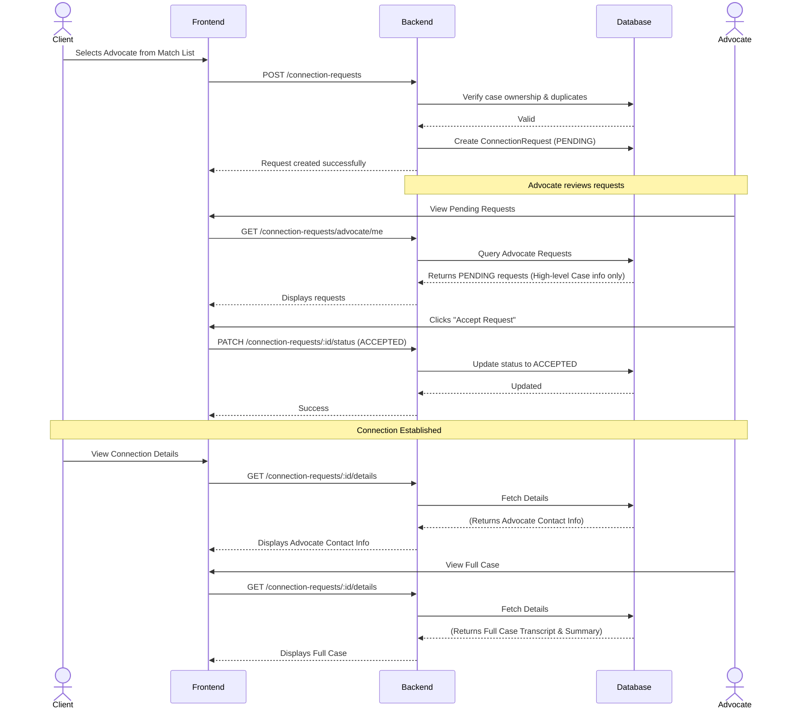

# Client-Advocate Connection Flow

This document visualizes the state machine and privacy workflow governing how a Client connects with an Advocate.

## Privacy Guidelines
- **Before Acceptance (`PENDING`)**: 
  - The Advocate can see high-level case details (Case Type, Jurisdiction, Urgency) but **not** the raw transcript or structured summary.
  - The Client cannot see the Advocate's direct contact information.
- **After Acceptance (`ACCEPTED`)**:
  - The Advocate gains full access to the case details to proceed with the legal consultation.
  - The Client gains access to the Advocate's contact details.

## Sequence Diagram

## Status Lifecycle
- **`PENDING`**: Initial state upon client request.
- **`ACCEPTED`**: Advocate agrees to consult. Exposes data to both parties.
- **`DECLINED`**: Advocate refuses the request. Terminates workflow.
- **`CANCELLED`**: Client retracts the request before advocate decides. Terminates workflow.
